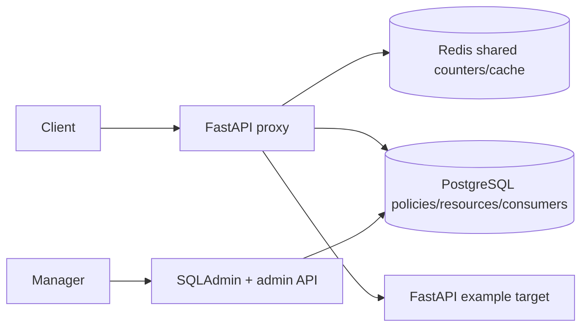

# Architecture

The proxy is a separate service from the example target (assumption N1). It discovers target methods and paths from `/openapi.json` into `resources`, grouped under `target-api`. Requests present a bearer value equal to consumer ID; the proxy resolves its group and matching assignment, atomically increments a Redis fixed-window counter, then forwards allowed requests with `httpx`.

## Schema

Tables: `policies`, `resources`, `resource_groups`, `consumers`, `consumer_groups`, `consumer_groups_policies`, and `service_settings`. Consumers require a group FK. Assignment references are polymorphic (`relationship_type`, integer `resource_id`) and are checked by the API; PostgreSQL cannot enforce both possible foreign keys with this representation.

## API

- `POST /admin-api/resources/sync`: discover target OpenAPI operations.
- `GET/POST /admin-api/policies`, `PUT/DELETE /admin-api/policies/{id}`: policy CRUD.
- `GET /admin-api/assignments`, `POST /admin-api/assignments`, `PUT/DELETE /admin-api/assignments/{id}`: assignment management.
- `/admin`: SQLAdmin model interface.
- Any other path: bearer-authenticated transparent target request; 401 for missing identity and 429 when exhausted.

All error responses contain `error`, `resource`, and `https_status_code`. PostgreSQL stores configuration; Redis performs atomic counter increments shared across instances. A bounded TTL local LRU resolves configuration, and admin API mutations clear local and Redis policy-cache keys.
