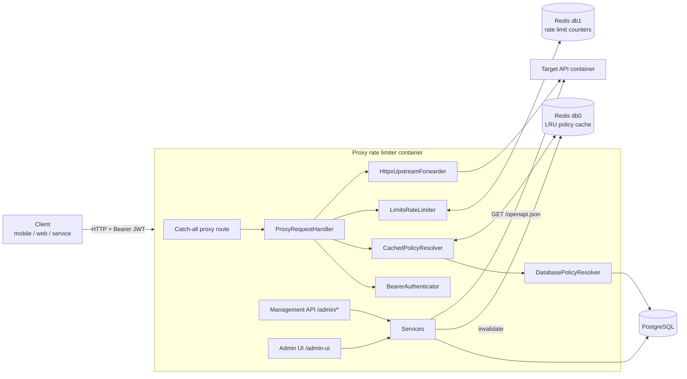
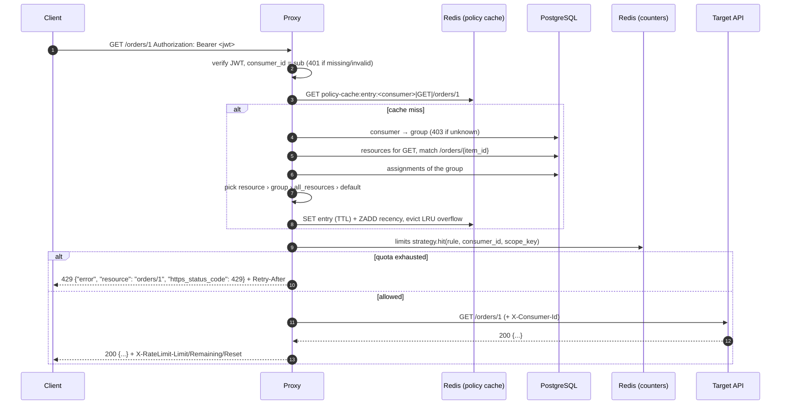
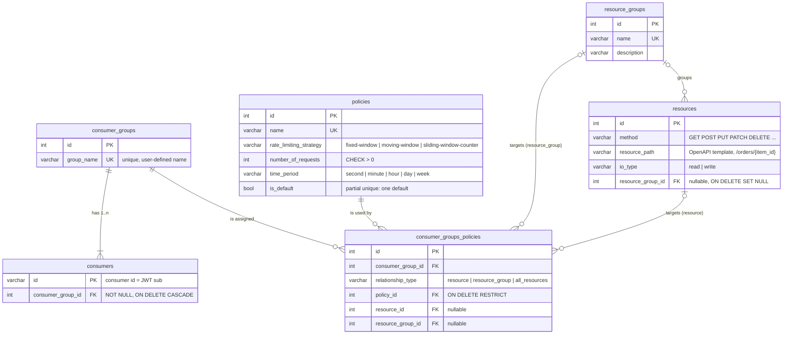

# 02 — Architecture and design

## High-level components



Two containers (proxy and target API) plus PostgreSQL and Redis, wired with docker
compose. The proxy runs several uvicorn workers — independent instances that only share
PostgreSQL and Redis, which is what makes the limits distributed.

### Layers inside the proxy

| Layer | Package | Depends on |
|---|---|---|
| Domain: enums, value objects, errors | `proxy.domain` | nothing |
| Ports: Protocols the core needs | `proxy.ports` | domain |
| Use cases | `proxy.services` | domain, ports, repositories |
| Persistence | `proxy.db`, `proxy.repositories` | domain |
| Adapters: Redis, limits, httpx, JWT, OpenAPI | `proxy.infrastructure` | domain (implements ports) |
| Delivery: FastAPI routers, error handlers, Admin UI | `proxy.api`, `proxy.admin_ui` | services |
| Composition root | `proxy.api.container_factory`, `proxy.api.dependencies`, `proxy.app_factory` | everything |

## Request execution flow (CUC1)



Management changes (`/admin/*` or Admin UI) commit to PostgreSQL and then drop the whole
policy cache.

## Database schema



Constraints enforced by PostgreSQL:

* `UNIQUE(method, resource_path)` on resources; unique names on policies and groups.
* `CHECK` on `consumer_groups_policies`: the target column(s) match `relationship_type`.
* `UNIQUE(consumer_group_id, resource_id)`, `UNIQUE(consumer_group_id, resource_group_id)`
  and a partial unique index allowing one `all_resources` row per consumer group.
* Enum columns are `VARCHAR` + `CHECK` (no native enum types, simpler migrations).

Constraints enforced by the services (they span rows or tables):

* No overlap between a resource assignment and its resource group's assignment for the
  same consumer group — checked on assignment create/update **and** when a resource moves
  into a group (`AssignmentConflictChecker`).
* A consumer group keeps at least one consumer (`ConsumerMembershipGuard`).
* The default policy cannot be deleted; a policy in use cannot be deleted.

## API contracts

Base path for management: `/admin`. OpenAPI: `/admin/docs`, `/admin/openapi.json`.

| Method & path | Body | Result |
|---|---|---|
| `POST /admin/consumer-groups` | `{group_name, consumer_ids[1..]}` | 201 group |
| `GET /admin/consumer-groups[/{id}]` | | 200 |
| `PATCH /admin/consumer-groups/{id}` | `{group_name}` | 200 |
| `DELETE /admin/consumer-groups/{id}` | | 204 (deletes its consumers and assignments) |
| `POST /admin/consumers` | `{id, consumer_group_id}` | 201 |
| `GET /admin/consumers[?consumer_group_id=]`, `GET /admin/consumers/{id}` | | 200 |
| `PATCH /admin/consumers/{id}` | `{consumer_group_id}` | 200 (409 for a group's last consumer) |
| `DELETE /admin/consumers/{id}` | | 204 (409 for a group's last consumer) |
| `POST /admin/policies` | `{name, rate_limiting_strategy?, number_of_requests, time_period}` | 201 |
| `GET /admin/policies[/{id}]`, `GET /admin/policies/strategies` | | 200 |
| `PATCH /admin/policies/{id}` | any policy field | 200 |
| `DELETE /admin/policies/{id}` | | 204 (409 default / in use) |
| `POST /admin/resources/sync` | | 200 `{discovered, created}` (502 if swagger unreachable) |
| `GET /admin/resources[?resource_group_id=]`, `GET /admin/resources/{id}` | | 200 |
| `PATCH /admin/resources/{id}` | `{io_type?, resource_group_id?}` | 200 (409 on overlap) |
| `DELETE /admin/resources/{id}` | | 204 |
| `POST /admin/resource-groups` | `{name, description?, resource_ids?}` | 201 |
| `GET/PATCH/DELETE /admin/resource-groups/{id}` | `{name?, description?, resource_ids?}` | 200/204 |
| `POST /admin/consumer-groups-policies` | `{consumer_group_id, relationship_type, policy_id, resource_id?, resource_group_id?}` | 201 (409 conflict) |
| `GET /admin/consumer-groups-policies[?consumer_group_id=]`, `GET …/{id}` | | 200 |
| `PATCH /admin/consumer-groups-policies/{id}` | `{policy_id?, relationship_type?, resource_id?, resource_group_id?}` | 200 |
| `DELETE /admin/consumer-groups-policies/{id}` | | 204 |
| `POST /admin/tokens` | `{consumer_id, ttl_seconds?}` | 201 `{access_token, token_type, expires_in}` |
| `GET /health` | | 200 |
| `ANY /{path}` (GET, POST, PUT, PATCH, DELETE, HEAD, OPTIONS) | forwarded | target's response, or 401/403/429/502 |

Every error, everywhere:

```json
{"error": "<human readable message>", "resource": "<path without leading slash>", "https_status_code": 429}
```

## Component responsibilities

| Component | Responsibility |
|---|---|
| `ProxyRequestHandler` | Coordinates CUC1: authenticate → resolve → count → forward or reject. |
| `BearerAuthenticator` + `JwtTokenCodec` | Parse `Authorization`, verify the JWT, produce a `ConsumerId`. |
| `CachedPolicyResolver` | Decorator: Redis LRU lookup by `(consumer, method, path)` before the DB. |
| `DatabasePolicyResolver` | Consumer → group → assignments; falls back to the default policy. |
| `ResourceLocator` | Matches a concrete path to the most specific OpenAPI template. |
| `PolicySelector` + matchers | Precedence rules, one matcher class per relationship type (open/closed). |
| `LimitsRateLimiter` | Atomic counting in Redis with the policy's own strategy. |
| `RedisLruPolicyCache` | TTL entries + sorted-set recency; capacity eviction; global invalidation. |
| `HttpxUpstreamForwarder` | Forwards method, path, query, headers, body; strips hop-by-hop headers. |
| `OpenApiSpecSource` / `ResourceDiscoveryService` | Import endpoints from swagger, idempotently. |
| `*Service` classes | Management use cases with business rules. |
| `AssignmentConflictChecker` | MUC1 AC1 overlap rules (API, Admin UI, resource moves). |
| `SqlAlchemyUnitOfWork` | One transaction + repositories; invalidates the cache after commit; maps integrity errors to 409. |
| `error_handlers` / `ExceptionLoggingMiddleware` | Uniform JSON errors; logging with location and traceback. |
| `admin_ui` views | sqladmin CRUD for every table, reusing the same guards and invalidation. |

## Concurrency and multiple instances

* **Counters are shared.** Every instance counts in the same Redis using `limits`
  strategies. Moving window and sliding window counter run as Lua scripts; fixed window
  uses atomic `INCR` + `EXPIRE`. Two instances cannot both admit the last request.
  `test_cuc1_limit_holds_across_several_proxy_instances` alternates two app instances.
* **The cache is shared.** The LRU cache lives in Redis, so one invalidation reaches every
  instance; there is no per-process state to drift.
* **No in-process state** besides connection pools; any instance can serve any request,
  so instances scale horizontally behind a load balancer.
* **Fully async I/O**: asyncpg, redis-py asyncio and httpx keep one worker serving many
  concurrent requests.
* **Startup race**: every worker bootstraps the default policy; a partial unique index
  admits exactly one, losers re-read it.
* **Cache invalidation race**: a request that resolved a policy just before a commit may
  write the old result back right after the invalidation; it lives at most `LRU_CACHE_TTL`.
  See 03-design-decisions for the mitigation options.
