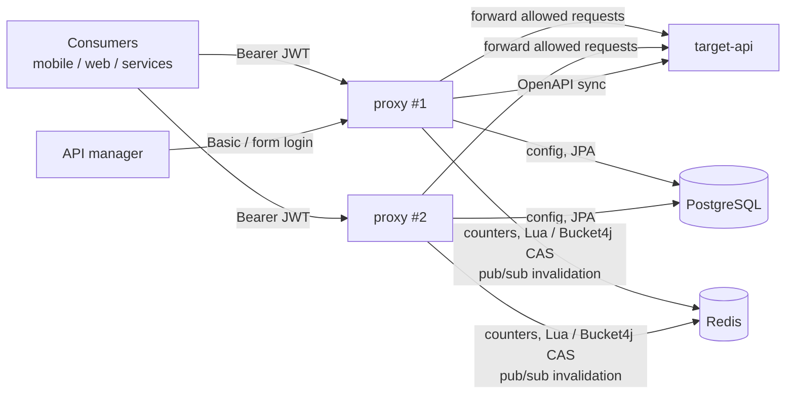
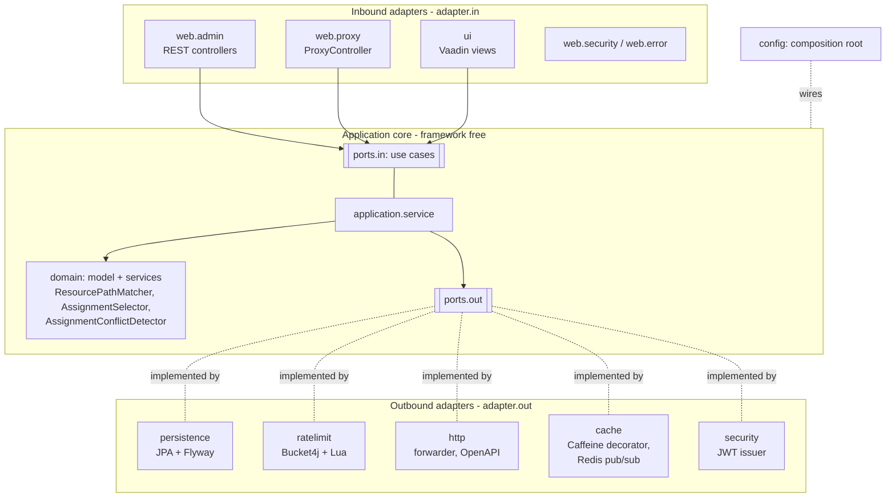
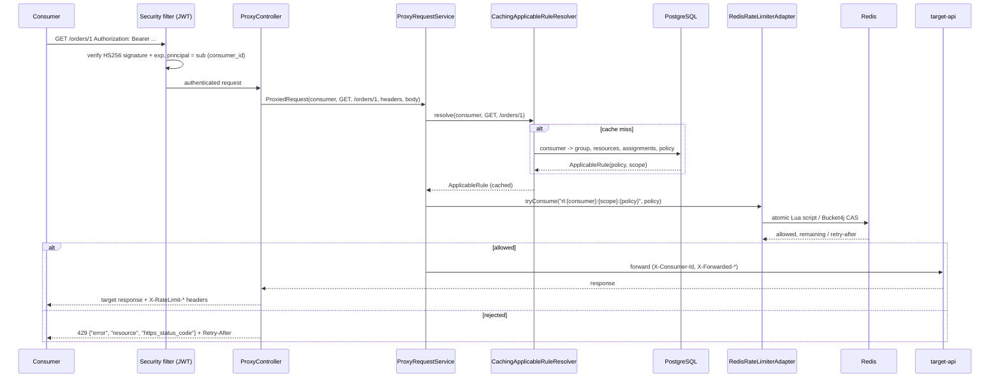
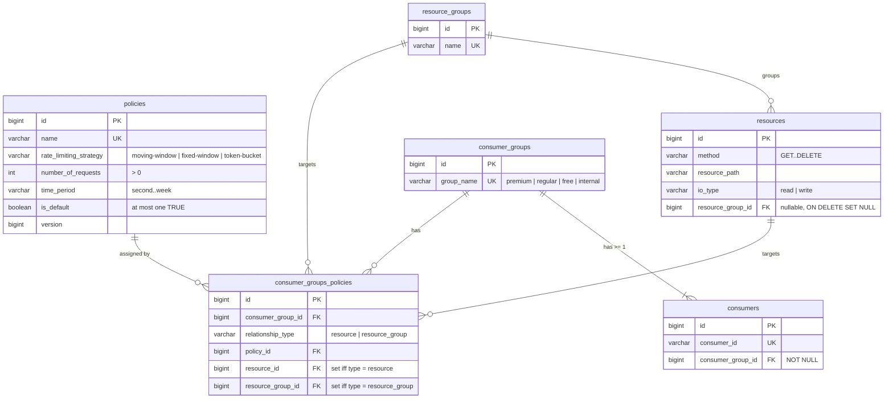

# 02 - Architecture and design

## High-level component architecture

Two containers run application code (plus PostgreSQL and Redis):

* **target-api** - a stub Spring Boot REST API (`/orders`, `/users`, `/carts`; GET, POST, PUT,
  PATCH) that logs every request and publishes OpenAPI at `/v3/api-docs`.
* **proxy** - the Proxy Rate Limiter. Any number of instances can run side by side
  (`./run.sh --multi` starts two); they share PostgreSQL (configuration) and Redis (counters,
  cache invalidation).



### Hexagonal structure of the proxy



* **domain** - immutable records and pure services; depends only on the JDK.
* **application** - use-case interfaces (`port.in`), required interfaces (`port.out`) and their
  orchestration (`service`); depends only on the domain. Transactions go through
  `UnitOfWorkPort`, cache invalidation through `RuleCacheInvalidationPort`.
* **adapters** - Spring MVC, Vaadin, Spring Security, JPA, Redis, JDK HttpClient.
* **config** - the composition root that instantiates the core with `@Bean` methods.

These rules are enforced by `HexagonalArchitectureTest` (ArchUnit).

## Request execution flow (CUC1)



Rule resolution: consumer -> consumer group -> best matching resource (OpenAPI template
matching; the most literal segments win) -> resource-level assignment, else resource-group
assignment, else the default policy. The **scope** decides which requests share a counter:
`resource:{id}`, `resource-group:{id}`, `default:resource:{id}` or `default:unmatched`.

## Database schema



Constraints (`db/migrations`):

* `UNIQUE(method, resource_path)`, unique names, enum CHECKs, `number_of_requests > 0`.
* Partial unique index: a single default policy.
* `cgp_exactly_one_target` CHECK and partial unique indexes `(consumer_group_id, resource_id)`
  / `(consumer_group_id, resource_group_id)`: one assignment per target and group.
* Trigger `prevent_overlapping_assignment` and `prevent_overlap_on_regroup`: a resource may not be
  assigned directly while its resource group is assigned for the same consumer group.
* Deferred constraint triggers: a consumer group must contain at least one consumer at commit.
* V2 inserts the default policy from `.env` values (Flyway placeholders).

## API contracts

All JSON uses `snake_case`; enum values use their external codes. Admin endpoints require HTTP
Basic (`ADMIN_USERNAME`/`ADMIN_PASSWORD`). Lists accept `page` (0-based) and `size` (1..500) and
return `{content, page, size, total_elements, total_pages}`.

| Method & path | Purpose |
|---|---|
| `GET/POST /admin/api/policies`, `GET/PUT/DELETE /admin/api/policies/{id}` | MUC4 CRUD; filters `name`, `strategy` |
| `GET /admin/api/policies/strategies` | supported strategies, default strategy, time periods |
| `GET /admin/api/policies/default` | MUC3 default policy |
| `GET/POST /admin/api/consumer-groups`, `GET/PUT/DELETE .../{id}`, `GET .../names` | MUC1.1; POST body `{group_name, consumer_ids[]}` |
| `GET/POST /admin/api/consumers`, `GET/PUT/DELETE .../{id}` | MUC1.2; filters `consumer_id`, `consumer_group_id` |
| `GET/POST /admin/api/resource-groups`, `GET/PUT/DELETE .../{id}` | resource groups |
| `GET/POST /admin/api/resources`, `GET/PUT/DELETE .../{id}` | resources; filters `path`, `method`, `io_type`, `resource_group_id` |
| `POST /admin/api/resources/sync` | MUC1.4 import from OpenAPI -> `{created[], unchanged, stale[]}` |
| `GET/POST /admin/api/consumer-groups-policies`, `GET/PUT/DELETE .../{id}` | MUC1.5 / MUC2; body `{consumer_group_id, relationship_type, policy_id, resource_id}`; filters `consumer_group_id`, `relationship_type`, `policy_id` |
| `POST /admin/api/tokens` | dev token `{consumer_id}` -> `{access_token, token_type, expires_at}` |
| `DELETE /admin/api/cache` | evict the rule cache on all instances |
| `/ui/**` | MUC6 Vaadin admin UI (form login) |
| `/actuator/health`, `/actuator/caches`, `/actuator/metrics` | health public, rest ADMIN |
| *anything else* | proxied consumer traffic (Bearer JWT) |

Example policy:

```json
{"id": 2, "name": "regular-100-per-minute", "rate_limiting_strategy": "moving-window",
 "number_of_requests": 100, "time_period": "minute", "default_policy": false}
```

Errors (every 4xx/5xx of the proxy, including security errors):

```json
{"error": "You exceeded the request capacity for the current period", "resource": "orders/1", "https_status_code": 429}
```

| Status | When |
|---|---|
| 400 | validation errors, unknown enum codes |
| 401 | missing/invalid bearer token or admin credentials |
| 403 | valid token of an unregistered consumer |
| 404 | unknown entity / reserved path |
| 409 | uniqueness, overlap, last-consumer and in-use rules |
| 429 | rate limit exceeded (`Retry-After`, `X-RateLimit-Limit/Remaining/Policy/Strategy`) |
| 502 / 504 | target unreachable / timed out |
| 503 | Redis unavailable (fail closed) |

## Component responsibilities

| Component | Responsibility |
|---|---|
| `ProxyController` | catch-all endpoint, maps outcome to HTTP (200 relay or 429) |
| `ProxyRequestService` | evaluate, then forward or reject |
| `EvaluateRequestService` | resolve rule, build counter key, consume |
| `ApplicableRuleResolutionService` | DB-backed rule resolution (+ default fallback) |
| `CachingApplicableRuleResolver` | `@Cacheable` decorator (Caffeine) |
| `RedisBroadcastRuleCacheInvalidator` / `LocalRuleCacheEvictor` | `@CacheEvict` locally + pub/sub to other instances |
| `RuleAffectingTransaction` | commit configuration change, then invalidate |
| `*Service` (policies, consumers, ...) | CRUD use cases and business rules |
| `AssignmentConflictDetector`, `AssignmentSelector`, `ResourcePathMatcher` | pure domain rules |
| `RedisRateLimiterAdapter` | strategy dispatch, Redis failures -> 503 |
| `SlidingWindowLogAlgorithm` / `Bucket4jAlgorithm` | the three algorithms |
| `JdkHttpUpstreamForwarder`, `OpenApiCatalogAdapter` | target API access |
| `*PersistenceAdapter`, `TransactionTemplateUnitOfWork` | JPA persistence, transactions |
| `GlobalExceptionHandler`, `ExceptionLoggingFilter`, JSON security handlers | uniform JSON errors, logging with stack traces |

## Concurrency and multiple instances

* **Counters** live only in Redis. `moving-window` is one Lua script (trim, count, add, expire)
  that Redis executes atomically and that reads Redis' own clock (`TIME`), so instance clock skew
  does not matter. `fixed-window` and `token-bucket` use Bucket4j's Lettuce proxy manager, which
  updates bucket state with compare-and-swap and retries on contention. Two instances therefore
  never double-spend a token; this is proven by `DistributedRateLimitIT`, which drives two
  independently wired limiter instances concurrently for every strategy.
* **Configuration writes** serialise per consumer group with `SELECT ... FOR UPDATE` on the
  `consumer_groups` row, so concurrent assignment changes cannot both pass the overlap check and
  two deletions cannot both remove "not the last" consumer. Database triggers back this up.
* **Rule cache** is per instance (Caffeine). After the change commits, the instance evicts its
  own cache and publishes an invalidation on Redis; every other instance evicts on receipt.
  The TTL bounds staleness if a message is lost.
* **Request handling** runs on virtual threads (`spring.threads.virtual.enabled`), so blocking
  calls to Redis, PostgreSQL and the target are cheap; no reactive stack is needed.
