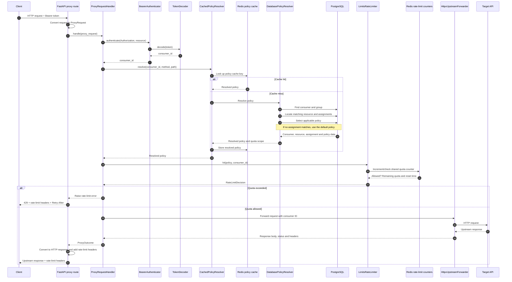

# Rate limiter proxy sequence diagram

The proxy authenticates the bearer token, resolves the consumer's policy, and checks the shared rate-limit counter. If the request is allowed, it forwards it to the target API; otherwise, it returns a `429` response without forwarding.

